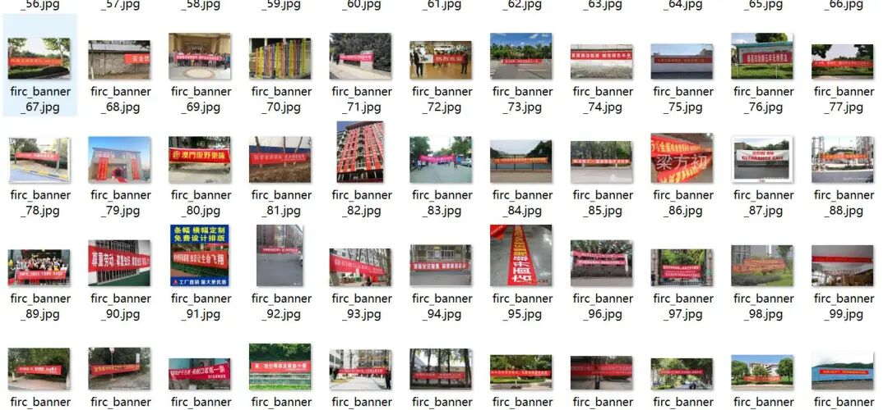
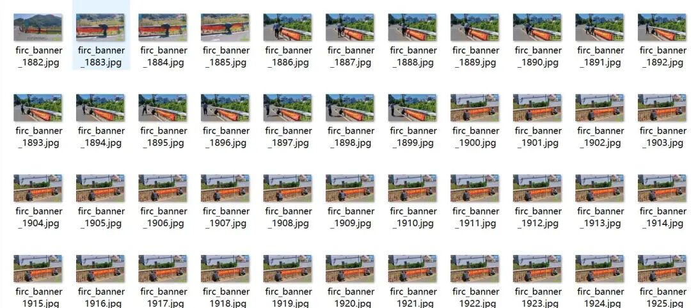
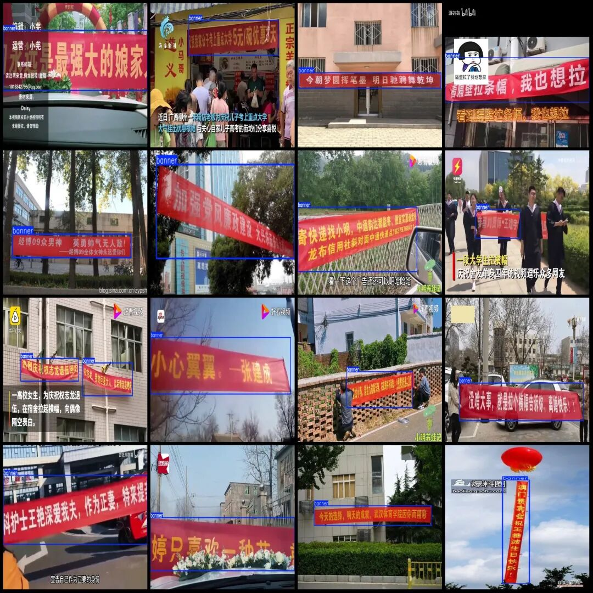

# Vehicle Recognition Detection Dataset VOC+YOLO format with 1 category, 1962 images.

The banner images are all in Chinese, most of which are screenshots from video clips.

Dataset format: Pascal VOC format (txt file without split path, only contains jpg images and corresponding VOC format xml files and yolo format txt files)

Number of images (number of jpg files): 1962

Number of annotations (number of xml files): 1962

Number of annotations (number of txt files): 1962

Label category count: 1

Label category name: ["banner"]

Number of boxes labeled in each category:

Banner Frame Count = 2227

Total frame count: 2227

Using labelImg:

Annotation rules: Draw a rectangle around the category.

Important Notice: No

Special : This dataset does not guarantee the accuracy or precision of the trained models or weight files. The dataset is provided with accurate and reasonable annotations only.

Image Preview:

Annotation example:

## Payment

Here is a pay link on Stripe ( https://buy.stripe.com/3cs8yP7sY87d0vu9AB ). Please contact me lonlonago@foxmail.com after funding $89, and I will send you a complete data files , thank you!

